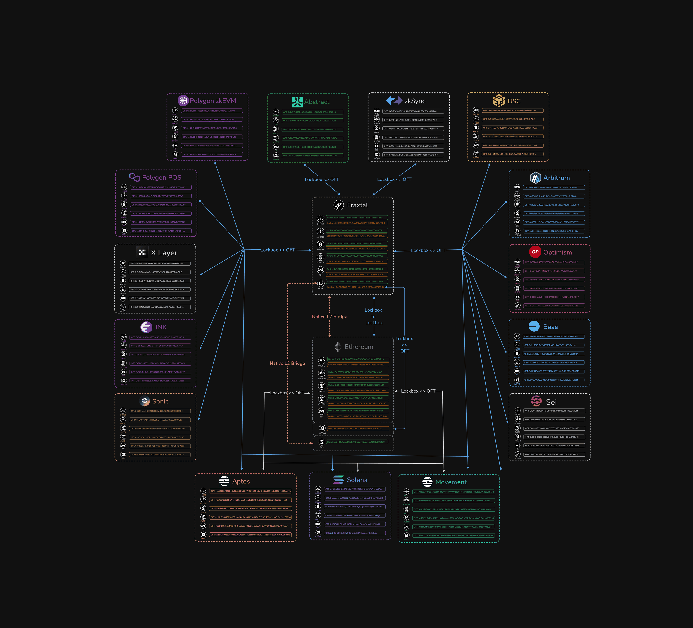
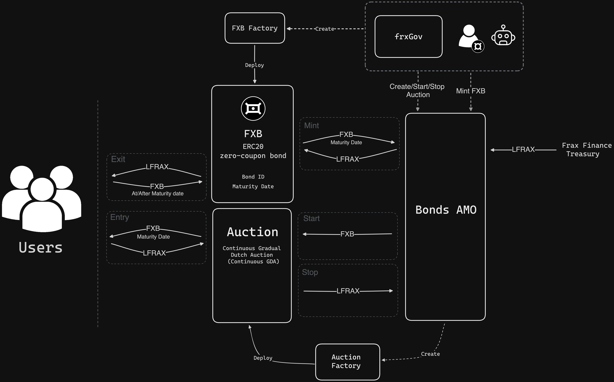
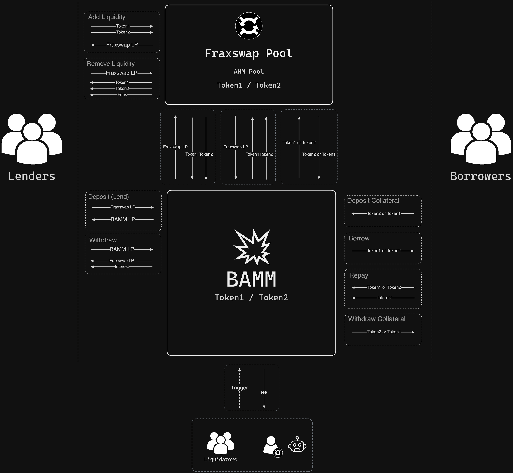
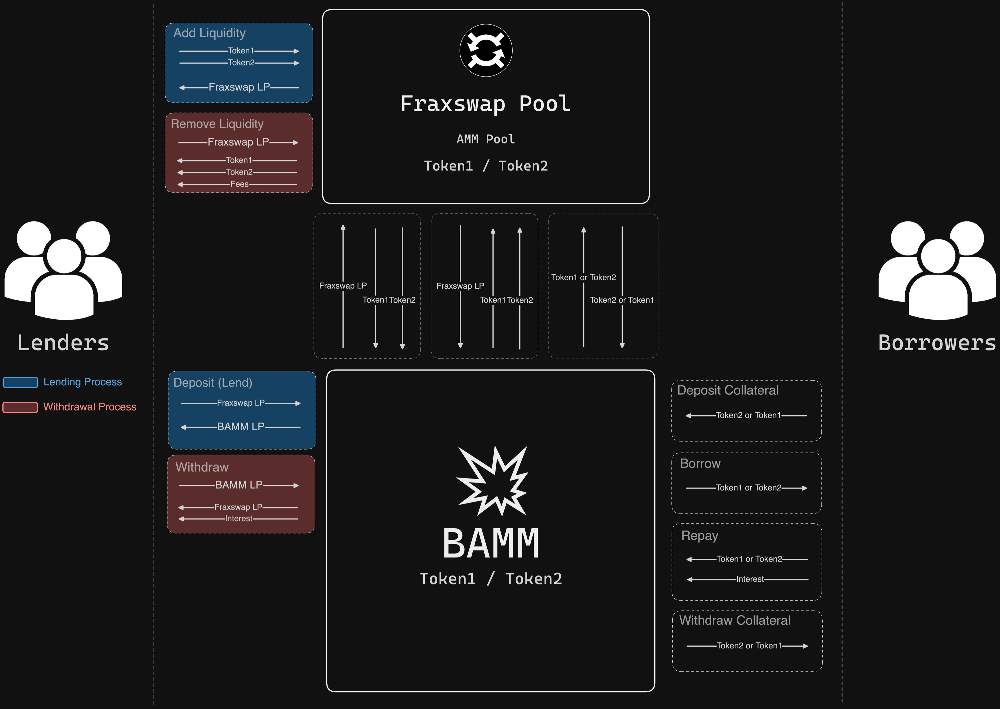
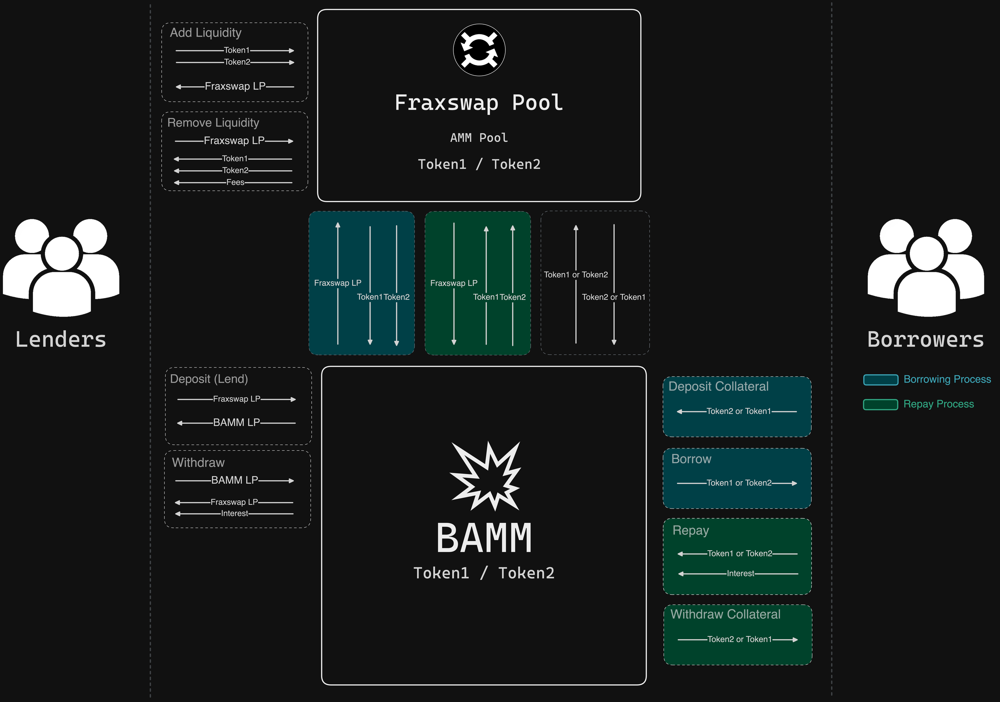

# Carter Carlson

Software engineer and AI developer. I build production systems where mistakes cost real money, and the agent workflows that help ship them safely. Python, TypeScript, Go, Rust, Solidity.

## Impact

| | |
|---|---|
| **$1B** peak TVL | [Aerodrome](https://github.com/aerodrome-finance/contracts), built on the [Velodrome v2 contracts](https://github.com/velodrome-finance/contracts) I co-authored |
| **900K** users | unique addresses through Aerodrome's main router; peak **28K** daily active addresses |
| **24K** daily users | Velodrome v2 peak on Optimism, three months after launch; **$100M+** migrated at launch |
| **$250M** moved | across EVM, Solana and Aptos on Frax's crosschain tokens; multisig ops cut from O(n) to O(1) |
| **$281M** peak TVL | [Fraxtal](https://docs.frax.com/fraxtal) L2, where I ran live protocol upgrades; peak **10K** daily and **39K** monthly active addresses |
| **$140M** peak market cap | frxUSD, one of the stablecoins carried by the crosschain token system above |
| **$40M** issued | [FXB](https://docs.frax.com/protocol/subprotocols/fxb/overview) bonds, where I was lead engineer |
| **$0** | user funds lost |

User counts are active addresses from [growthepie](https://www.growthepie.com/applications/aerodrome-finance) labeled contracts. Peak TVL and the frxUSD market cap are from [DefiLlama](https://defillama.com) (market cap via CoinGecko).

## Building with AI

- **[Crossecute](https://github.com/crossecute)**: multi-agent workflows on every commit, PR and issue, governed by repo rules and layered AI review.
- **[forge-attest](https://github.com/crossecute/forge-attest)**: a GitHub Action that proves a multisig transaction matches a pinned script, shipped as a Claude Code plugin.
- **[agent-skills](https://github.com/pegahcarter/agent-skills)**: scheduled, least-privilege Claude agents with tested Python checks.
- I rolled out secure AI integration and automated PR review across a dozen engineers.
- [My global CLAUDE.md](https://gist.github.com/pegahcarter/6db56f1b3178f0e76b2613507a9fb599)

## Design

<b>Frax crosschain hub</b>: architecture diagram of Frax token flows across chains

 

<b>FXB bonds</b>: architecture diagram of the FXB zero-coupon bond system and Bonds AMO auctions

 

<b>BAMM</b>: overview, lender and borrower flow diagrams

 

  
<b>Lenders</b> 

  
<b>Borrowers</b> 

