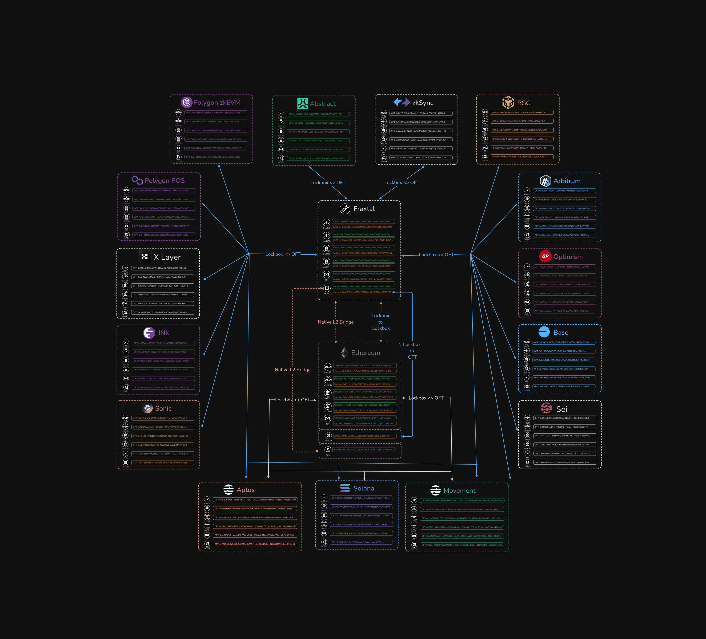
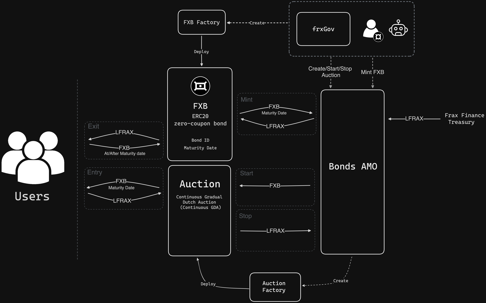
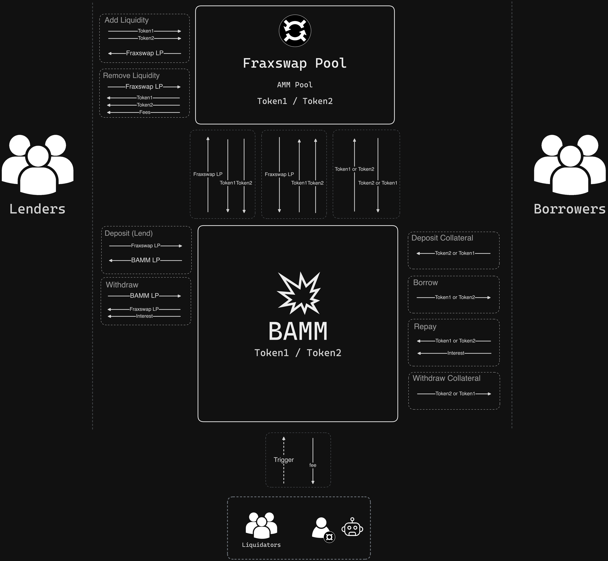
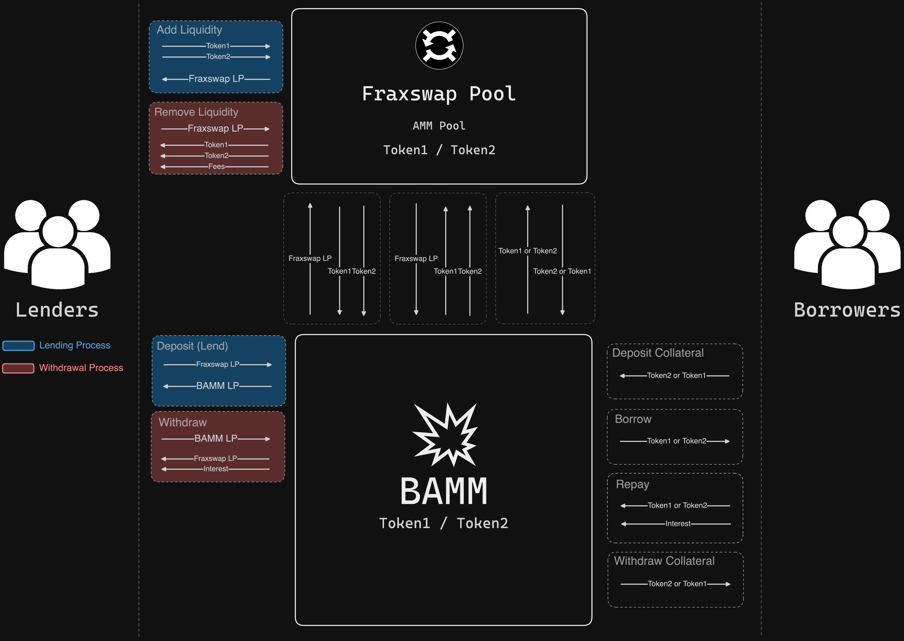
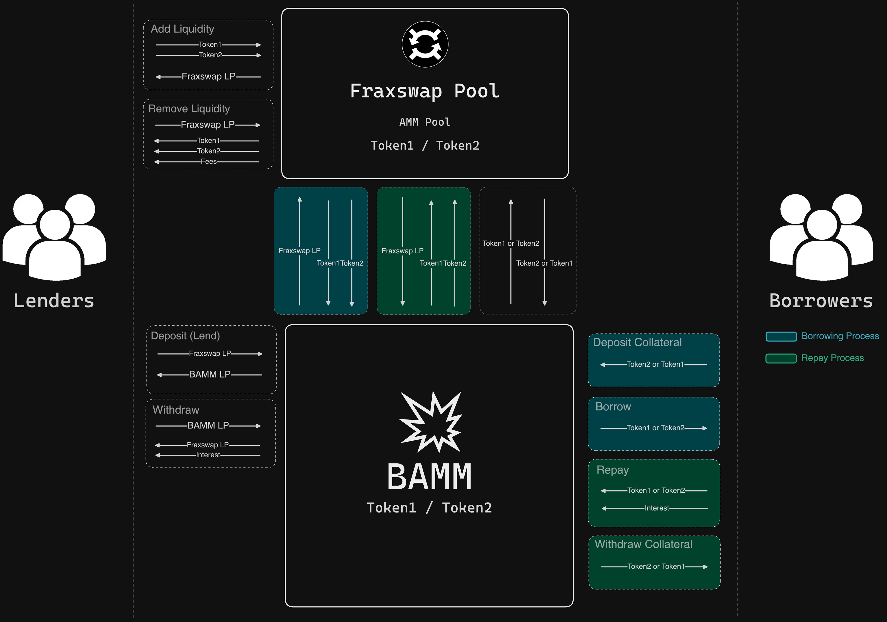

# Carter Carlson

**Senior Software Engineer**

I have shipped production systems for 5+ years, including a DEX that I co-authored and that grew to over $1B in TVL. I write Solidity, TypeScript, Python, Rust, Go and Bash, and I pick up a new language or runtime when the work needs it. I also have a background in formal security auditing and test-driven development.

**Languages:** Solidity · Yul · TypeScript · JavaScript · Python · Rust (Anchor) · Go · Bash · SQL · Move

## What I've built

### DEX

- **[Velodrome v2 contracts](https://github.com/velodrome-finance/contracts)**: the core contracts of Velodrome, a DEX on Optimism. I co-authored and deployed them, designed the NFT-based governance, and wrote the unit, integration, E2E and fuzz test suites in Foundry. [Aerodrome](https://github.com/aerodrome-finance/contracts) on Base is built from the same codebase. *Solidity*

### Multichain infrastructure

- **[Frax crosschain tokens](https://docs.frax.com/protocol/crosschain/overview)**: Frax's LayerZero tokens on EVM chains, Solana and Aptos. I led this work and wrote the core contracts of [Hop V2](https://github.com/FraxFinance/hop-v2), a bridge that routes tokens through a hub on Fraxtal. *Solidity, TypeScript*
- **[Solana deployment](https://github.com/FraxFinance/frax-oft-upgradeable/pull/50)**: deployed Frax's Anchor OFT program to Solana and wrote the first [TypeScript ops tasks](https://github.com/FraxFinance/frax-oft-upgradeable/tree/master/tasks/solana) that configure and run it. *Rust (Anchor), TypeScript*
- **[Aptos deployment](https://github.com/FraxFinance/frax-oft-upgradeable/tree/master/deploy-move)**: peer-reviewed the Move deploy and wiring code. *Move*
- **[frax-tron](https://github.com/FraxFinance/frax-tron)**: FRAX, sFRAX and FXS as TRC-20 tokens on Tron, with Fraxferry bridges to Fraxtal and a Tron multisig. Sole author. *Solidity, TypeScript*

### Lending and bonds

- **[FXB](https://docs.frax.com/protocol/subprotocols/fxb/overview)**: zero-coupon bonds sold by gradual Dutch auction. Lead engineer. *Solidity*
- **[BAMM](https://docs.frax.com/protocol/subprotocols/bamm/overview)**: oracle-free lending on Fraxswap. Core engineer. *Solidity*

### L2

- **[Fraxtal](https://docs.frax.com/fraxtal)**: an OP-Stack L2. Core engineer. I upgraded its OP-Stack protocol contracts and maintained live protocol upgrades. *Solidity*

### Protocol built from zero

- **[meTokens](https://github.com/meTokens/meTokens-core)**: built the protocol from zero with the founder, using EIP-2535 Diamonds and Bancor bonding curves. I wrote the TypeScript test suites and deploy scripts and led code review. *Solidity, TypeScript*

### Security and developer tooling

- **[forge-attest](https://github.com/crossecute/forge-attest)**: a GitHub Action that proves a queued Safe transaction is byte-for-byte the output of a pinned Forge script. Part of [crossecute](https://github.com/crossecute), a protocol for running one multisig across many chains. *Bash, Solidity*
- **[Frax development standards](https://docs.frax.com/protocol/standards/standards)**: I wrote Frax's published standards for PR review, scripted deploys, script-driven tests and upgrade safety, and added AI PR review across Frax's repos.
- **Auditing**: auditor at RaidGuild since 2020, on engagements for Valorem, MetaStreet and METL, among others. Before that, security research intern at Consensys Diligence, where I co-wrote the weekly security newsletter and shadowed full audits.

### Trading and data (earlier work)

- **[TAcharts](https://github.com/pegahcarter/TAcharts)** : a Python library for technical analysis and charting of OHLCV data, built on pandas, NumPy and matplotlib. *Python*
- **[rebalance](https://github.com/pegahcarter/rebalance)** : rebalance and backtest a crypto portfolio, with a React frontend and Python backtesting. *JavaScript, Python*

## Results

- $250M+ moved across chains on Frax's LayerZero tokens, with multisig operations cut from O(n) to O(1).
- $40M+ of FXB bonds issued in 18 months.
- $100M+ of TVL migrated into Velodrome v2.

<!-- BADGE:START -->

<!-- BADGE:END -->

<b>Live TVL and token stats</b> (updated daily)

### TVL of protocols I engineered

<!-- TVL:START -->
<picture>
  <source media="(prefers-color-scheme: dark)" srcset="https://raw.githubusercontent.com/pegahcarter/pegahcarter/refs/heads/main/assets/tvl-dark.svg">
  
</picture>

| Protocol | TVL now* | 3-year average* | Peak TVL* |
|---|---|---|---|
| [Aero](https://defillama.com/protocol/aero) | $377.6M | $579.2M | $1.35B (Dec 2024) |
| [Fraxtal](https://defillama.com/protocol/fraxtal) | $167.0M | $192.3M | $281.2M (Jul 2025) |

*Fetched 2026-10-28 06:05 UTC. See [the update script](scripts/update_tvl.py) for details.
<!-- TVL:END -->

### Tokens I developed

<!-- TOKENS:START -->
**Protocol tokens**

| Token | Chain | Market cap* | Peak market cap* | Contract |
|---|---|---|---|---|
| veAERO | Base | $567.8M | $1.50B (Dec 2024) | [`0xeBf4…e6B4`](https://basescan.org/address/0xeBf418Fe2512e7E6bd9b87a8F0f294aCDC67e6B4) |
| veVELO | Optimism | $27.0M | $242.0M (Dec 2024) | [`0xFAf8…787d`](https://optimistic.etherscan.io/address/0xFAf8FD17D9840595845582fCB047DF13f006787d) |

**Frax LayerZero OFTs\*\***

| Token | Market cap* | Peak market cap* |
|---|---|---|
| frxUSD | $99.3M | $140.1M (May 2026) |
| sfrxUSD | $39.1M | $46.1M (Apr 2026) |
| frxETH | $140.6M | $1.20B (Mar 2024) |
| sfrxETH | $100.6M | $856.0M (Mar 2024) |
| FRAX (WFRAX, formerly FXS) | $24.7M | $226.9M (Sep 2025) |

\*\*Contract addresses on every chain: [Frax docs](https://docs.frax.com/protocol/crosschain/addresses).

**FXB bonds**

| Bond | Chain | Maturity | Value Issued* | Contract |
|---|---|---|---|---|
| FXB_20240630 | Ethereum | 2024-06-30 | $4.3M | [`0x0dE5…df1e`](https://etherscan.io/address/0x0dE54CFdfeD8005176f8b7A9D5438B45c4F1df1e) |
| FXB_20241231 | Ethereum | 2024-12-31 | $4.7M | [`0xF8FD…6F09`](https://etherscan.io/address/0xF8FDe8A259A3698902C88bdB1E13Ff28Cd7f6F09) |
| FXB20251231 | Fraxtal | 2025-12-31 | $3.6M | [`0xacA9…C6CA`](https://fraxscan.com/address/0xacA9A33698cF96413A40A4eB9E87906ff40fC6CA) |
| FXB_20261231 | Ethereum | 2026-12-31 | $6.0M | [`0x7623…4ff3`](https://etherscan.io/address/0x76237BCfDbe8e06FB774663add96216961df4ff3) |
| FXB20271231 | Fraxtal | 2027-12-31 | $4.3M | [`0x6c9f…A818`](https://fraxscan.com/address/0x6c9f4E6089c8890AfEE2bcBA364C2712f88fA818) |
| FXB20291231 | Fraxtal | 2029-12-31 | $12.7M | [`0xF1e2…2153`](https://fraxscan.com/address/0xF1e2b576aF4C6a7eE966b14C810b772391e92153) |
| FXB20551231 | Fraxtal | 2055-12-31 | $13.6M | [`0xc381…EA83`](https://fraxscan.com/address/0xc38173D34afaEA88Bc482813B3CD267bc8A1EA83) |

*Fetched 2026-10-28 06:05 UTC. See [the update script](scripts/update_tvl.py) for details.
<!-- TOKENS:END -->

## Design

<b>Frax crosschain hub</b>: architecture diagram of Frax token flows across chains

 

<b>FXB bonds</b>: architecture diagram of the FXB zero-coupon bond system and Bonds AMO auctions

 

<b>BAMM</b>: overview, lender and borrower flow diagrams

 

  
<b>Lenders</b> 

  
<b>Borrowers</b> 

## How I work with AI

- [My global CLAUDE.md](https://gist.github.com/pegahcarter/6db56f1b3178f0e76b2613507a9fb599)
