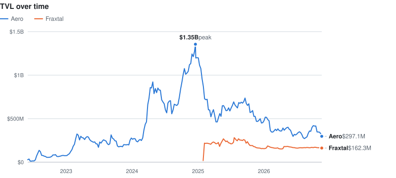

# Carter Carlson

Software engineer and AI developer. I build production systems where mistakes cost real money, and the agent workflows that help ship them safely. Python, TypeScript, Go, Rust, Solidity.

## Impact

| | |
|---|---|
| **$1B** peak TVL | [Aerodrome](https://github.com/aerodrome-finance/contracts), built on the [Velodrome v2 contracts](https://github.com/velodrome-finance/contracts) I co-authored |
| **900K** users | unique addresses through Aerodrome's main router; peak **28K** daily active addresses |
| **24K** daily users | Velodrome v2 peak on Optimism, three months after launch; **$100M+** migrated at launch |
| **$250M** moved | across EVM, Solana and Aptos on Frax's crosschain tokens; multisig ops cut from O(n) to O(1) |
| **$281M** peak TVL | [Fraxtal](https://docs.frax.com/fraxtal) L2, where I ran live protocol upgrades; peak **10K** daily and **39K** monthly active addresses |
| **$140M** peak market cap | frxUSD, one of the stablecoins carried by the crosschain token system above |
| **$40M** issued | [FXB](https://docs.frax.com/protocol/subprotocols/fxb/overview) bonds, where I was lead engineer |
| **$0** | user funds lost |

User counts are active addresses from [growthepie](https://www.growthepie.com/applications/aerodrome-finance) labeled contracts. frxUSD market cap is CoinGecko data via DefiLlama. TVL refreshes daily from [DefiLlama](scripts/update_tvl.py).

## Building with AI

- **[Crossecute](https://github.com/crossecute)** (founder): multi-agent workflows on every commit, PR and issue, governed by repo rules and layered AI review.
- **[forge-attest](https://github.com/crossecute/forge-attest)**: a GitHub Action that proves a multisig transaction matches a pinned script, shipped as a Claude Code plugin.
- **[agent-skills](https://github.com/pegahcarter/agent-skills)**: scheduled, least-privilege Claude agents with tested Python checks.
- At Frax, I rolled out AI agents and AI PR review across a dozen engineers and wrote the team's [engineering standards](https://docs.frax.com/protocol/standards/standards).
- [My global CLAUDE.md](https://gist.github.com/pegahcarter/6db56f1b3178f0e76b2613507a9fb599)

<b>Live TVL</b> (updated daily)

<!-- TVL:START -->
<picture>
  <source media="(prefers-color-scheme: dark)" srcset="https://raw.githubusercontent.com/pegahcarter/pegahcarter/refs/heads/main/assets/tvl-dark.svg">
  
</picture>

| Protocol | TVL now* | 3-year average* | Peak TVL* |
|---|---|---|---|
| [Aero](https://defillama.com/protocol/aero) | $287.6M | $574.3M | $1.35B (Dec 2024) |
| [Fraxtal](https://defillama.com/protocol/fraxtal) | $161.1M | $191.3M | $281.2M (Jul 2025) |

*Fetched 2026-11-19 21:16 UTC. See [the update script](scripts/update_tvl.py) for details.
<!-- TVL:END -->

